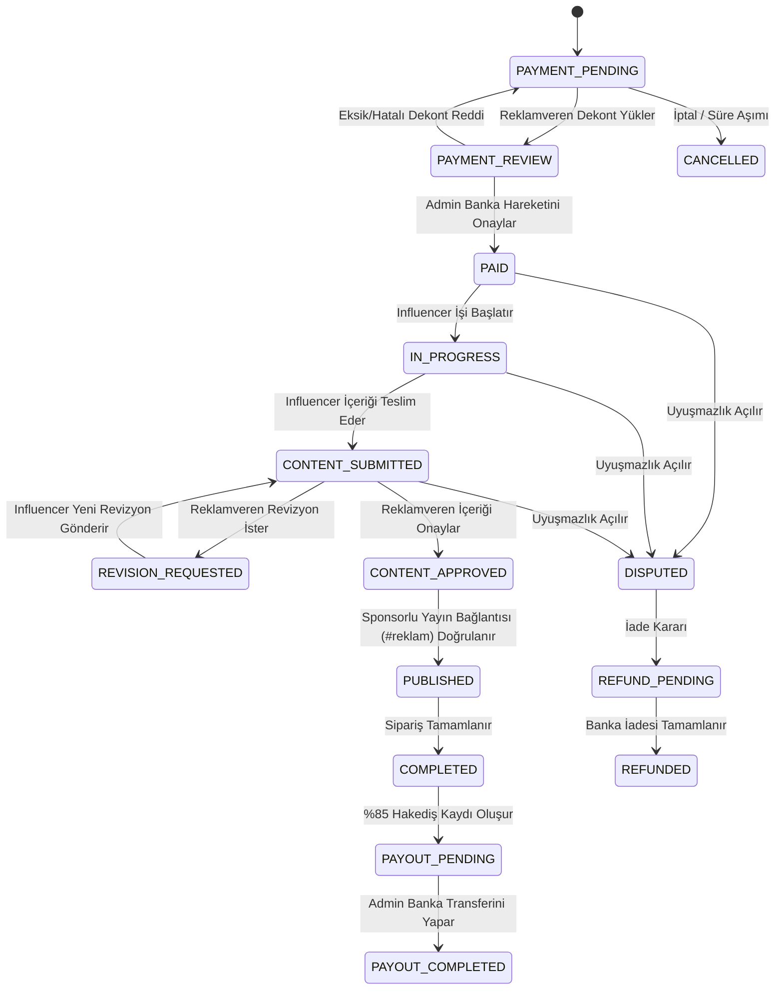

# InfluNex — Sipariş ve Banka Havalesi Akışı (PAYMENT-FLOW.md)

## 1. 6493 Sayılı Kanun Uyumluluğu ve Ticari Model

- İlk sürümde kredi kartı, sanal POS, dijital cüzdan veya kullanıcılar arası bakiye transferi **bulunmaz**.
- Ödemeler yalnızca **Banka Havalesi / EFT / FAST** ile şirket banka hesabına yapılır.
- `BANK_TRANSFER_LIVE_ENABLED=true` ve gerçek şirket IBAN/unvan bilgileri tanımlanmadan ödeme ekranında uydurma IBAN gösterilmez; açıkça konfigürasyon uyarısı sunulur.

## 2. 15 Durumlu Sipariş State Machine

## 3. Dekont ve Mükerrer Transfer Kontrolleri

- Dekont yüklemek ödemenin onaylandığı anlamına gelmez (`PAYMENT_REVIEW`).
- Yönetici banka ekstresinden gerçek tutarı, tarihi ve **Banka İşlem Referans Numarasını (`bankTransactionRef`)** kontrol ederek onaylar.
- Aynı `bankTransactionRef` numarasının birden fazla siparişte kullanılması backend tarafından kesin olarak engellenir.
